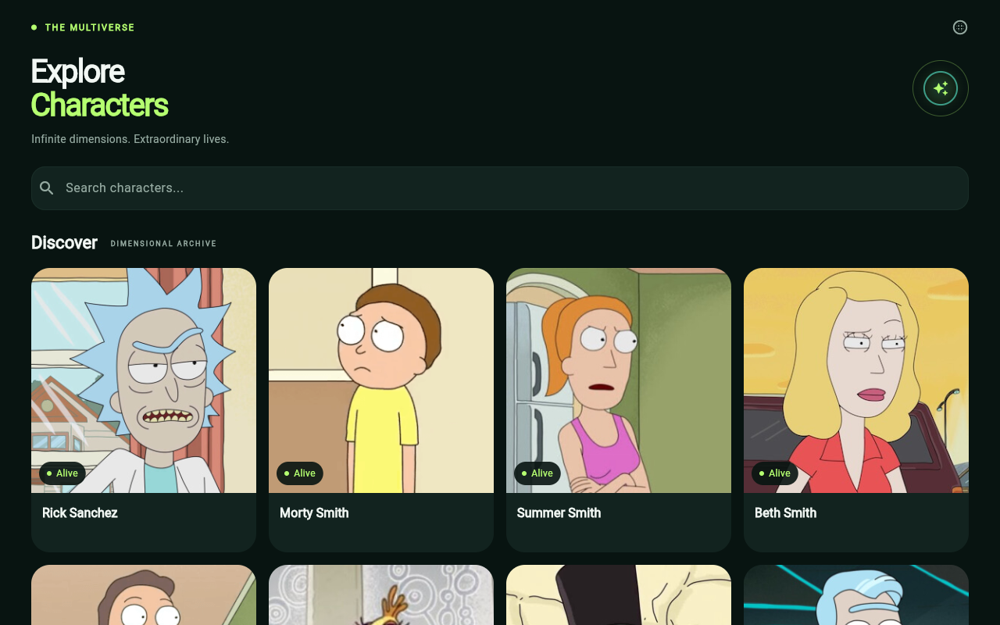
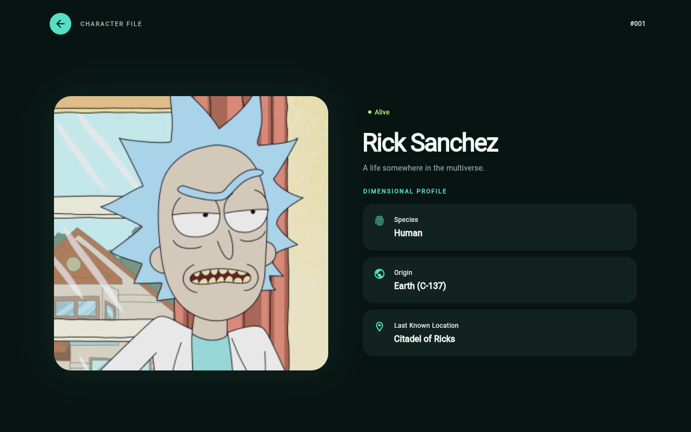
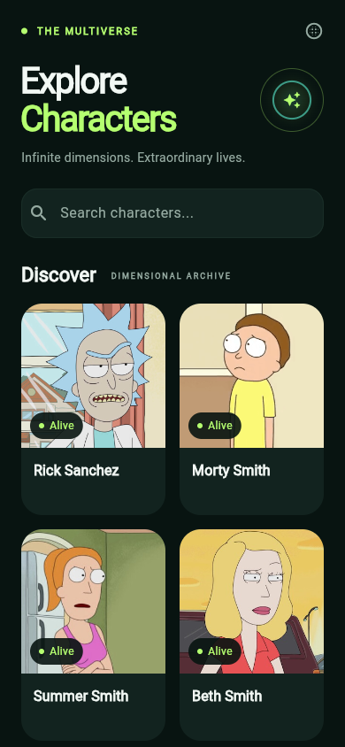
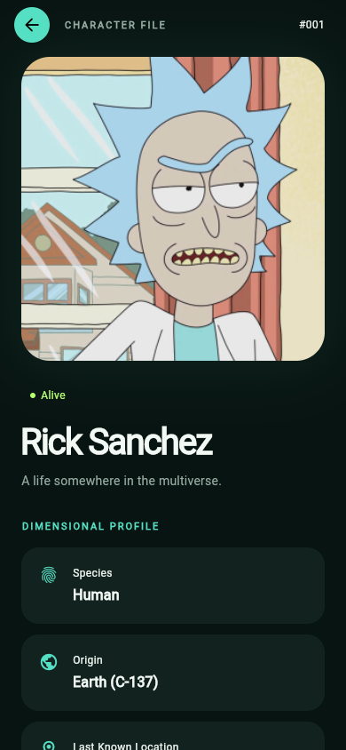

# Rick and Morty Character Catalog

Flutter-приложение для исследования вселенной Rick and Morty. Просматривайте каталог, ищите персонажей по имени и открывайте подробную информацию о них.

## Скриншоты

Десктопная компоновка, 1280 × 800.

| Каталог | Информация о персонаже |
| --- | --- |
|  |  |

Мобильная компоновка, 390 × 844.

| Каталог | Информация о персонаже |
| --- | --- |
|  |  |

## Возможности

- Каталог персонажей с адаптивной сеткой.
- Бесконечная прокрутка с отдельными состояниями загрузки и ошибки следующей страницы.
- Серверный поиск с задержкой 400 мс после ввода.
- Информация о персонаже: статус, вид, происхождение и последнее известное местоположение.
- Skeleton-загрузка, пустые результаты, резервное отображение изображений и сообщения об ошибках.
- Повторные попытки без потери уже загруженных персонажей.
- Сохранение поиска, загруженных страниц и позиции прокрутки при возврате с деталей.
- Двухколоночный экран деталей и более крупные карточки каталога на десктопе.

## Стек

- Flutter / Dart.
- flutter_bloc / Cubit.
- Dio.
- Equatable.
- CachedNetworkImage.

## Архитектура

Проект организован по функциональным модулям — feature-first. Внутри модуля выделены три слоя:

```text
lib/
  app/                              # Тема и создание зависимостей
  core/network/                     # Конфигурация Dio
  features/characters/
    presentation/                   # Cubit, состояние, экраны и виджеты
    domain/                         # Неизменяемые сущности и контракт репозитория
    data/                           # JSON DTO и реализация репозитория на Dio
```

Cubit объединяет загрузку, поиск, пагинацию и повторные попытки без дополнительного слоя событий. Контракт репозитория отделяет эту логику от HTTP и позволяет использовать fake-репозиторий в тестах. Domain не зависит от Flutter и Dio.

Версии запросов защищают состояние от устаревших ответов поиска и пагинации. Только HTTP 404 на первой странице поиска по имени превращается в пустой результат. Остальные ошибки запросов передаются в Cubit. Экран деталей использует выбранного персонажа без дополнительного запроса к API.

Зависимости создаются в `CatalogApp`. Каталожный `BlocProvider` управляет жизненным циклом Cubit; экран владеет контроллерами поиска и прокрутки. Для переходов используется стандартный `Navigator`.

## Запуск

Установите Flutter с Dart 3.10.7 или новее и настройте целевое устройство. API-ключ и файл переменных окружения не требуются.

```sh
flutter pub get
flutter run
```

Запуск в браузере:

```sh
flutter run -d chrome
```

## Проверки и тесты

```sh
dart format lib test
flutter analyze
flutter test
```

Тесты проверяют гонки запросов, задержку поиска, пагинацию и повторные попытки, сохранение состояния при навигации, экранную клавиатуру и адаптивную компоновку при увеличенном тексте. Используется fake-репозиторий: доступ к публичному API для тестов не нужен.

Команды сборки:

```sh
flutter build apk --debug
flutter build apk --release
flutter build web --release
```

Android release-сборка использует шаблонный отладочный ключ для проверки тестового задания. Перед публикацией в магазине приложений необходимо настроить подпись собственным ключом.

## API

Данные и изображения предоставляет публичный [Rick and Morty API](https://rickandmortyapi.com/documentation/#character). Запросы отправляются на `/api/character` с параметрами `page` и `name`. Наличие следующей страницы определяется по `info.next`.

## Дизайн

Сдержанный научно-фантастический архив: глубокие зелёные поверхности, лаймовые и бирюзовые акценты, крупные портреты и выразительная типографика. Hero-анимация связывает каталог и детали. Компоновка адаптируется к ширине экрана и масштабу текста. Дополнительные библиотеки дизайна и анимации не используются.
